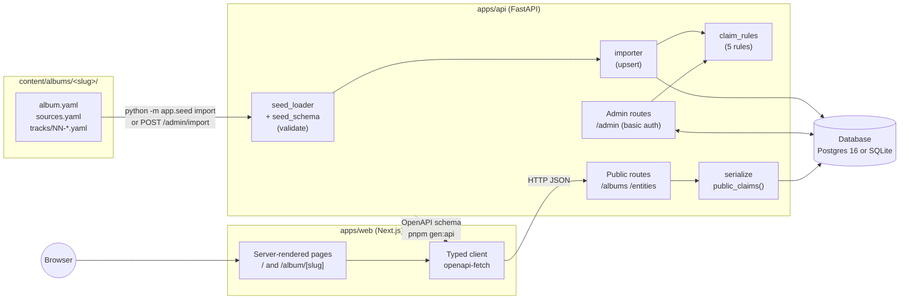
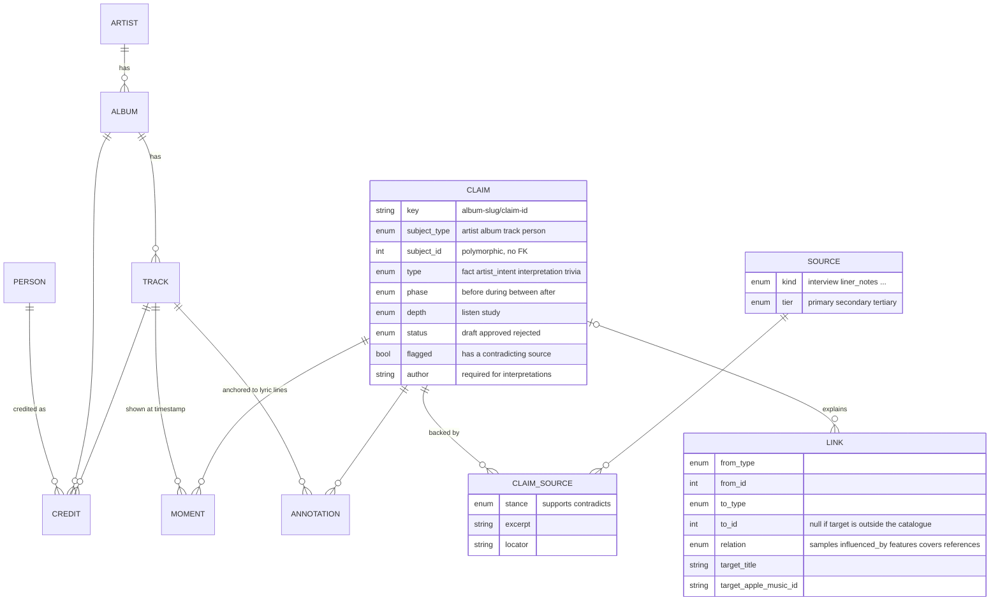
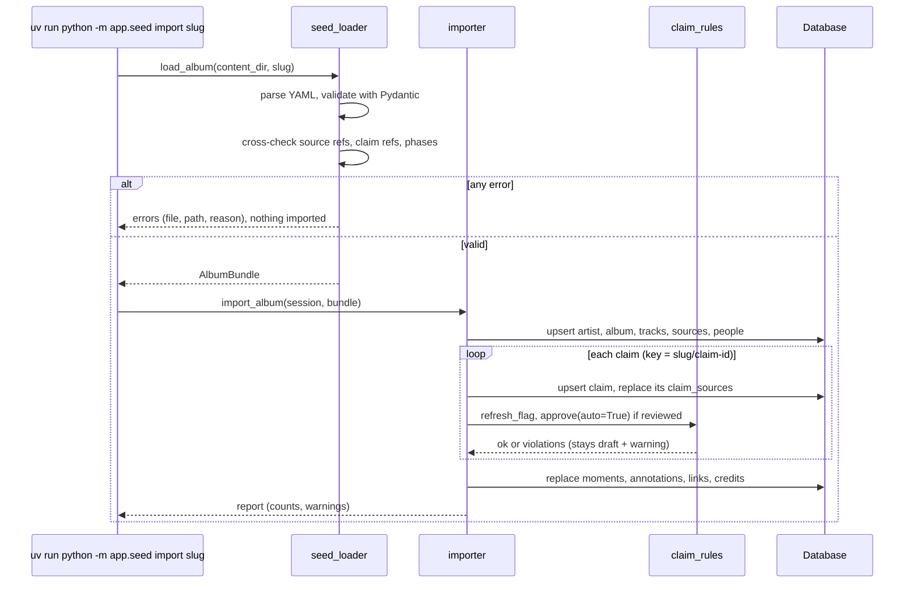
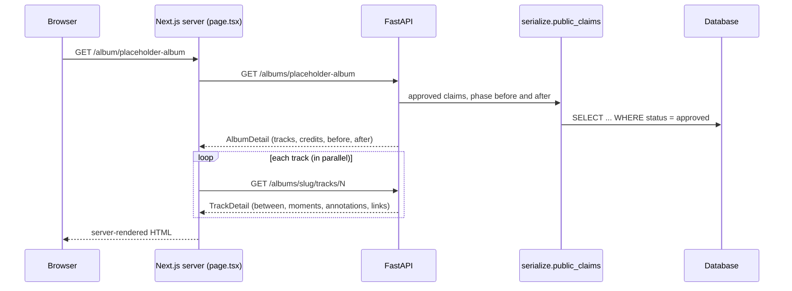
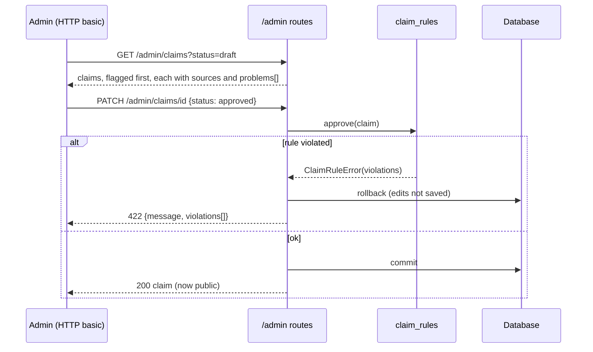

# Architecture

How the app is built today (after Milestone 4). For the product plan and milestones see [PLAN.md](PLAN.md).

**Status:** the app is runnable. You can browse the shelf, play an album and read about the song that is playing in a side panel (tabs: Now, Meaning, Album). An album can be played from its page: through Apple Music (about 30 s previews until full-length playback is switched on, see below) or, with no Apple credentials, through a demo player that has no audio. The listening screen phases, entity pages, the admin UI and the PWA shell are not built yet (Milestones 5 to 8).

## System overview



Two ideas run through everything:

1. **Everything a user reads is a claim.** A claim has a subject (artist, album, track), a type (fact, artist intent, interpretation, trivia), a phase (before, during, between, after), a depth (listen or study) and sources. Only `approved` claims are ever public.
2. **Content is data, not code.** Albums are hand-written YAML, validated and imported into the database. Review decisions live in the database and survive re-imports.

## Folder structure

```
runout/
├── apps/
│   ├── api/                         FastAPI backend (Python 3.12, uv)
│   │   ├── app/
│   │   │   ├── main.py              App, CORS, router registration
│   │   │   ├── config.py            Settings from env / .env
│   │   │   ├── db.py                Engine + SessionLocal
│   │   │   ├── deps.py              get_session, admin basic-auth dependency
│   │   │   ├── schemas.py           Pydantic request/response models (drive the TS client)
│   │   │   ├── seed.py              CLI: python -m app.seed import <slug>
│   │   │   ├── export_openapi.py    Writes the OpenAPI schema for the client
│   │   │   ├── models/              SQLAlchemy models + enums
│   │   │   ├── routes/              health, albums, entities, admin
│   │   │   ├── services/
│   │   │   │   ├── claim_rules.py   The five claim rules (single place status changes)
│   │   │   │   ├── seed_schema.py   Pydantic models for the YAML files
│   │   │   │   ├── seed_loader.py   Read + validate + cross-reference seed files
│   │   │   │   ├── importer.py      Idempotent upsert into the database
│   │   │   │   └── serialize.py     ORM -> API models; approved-only claim queries
│   │   │   └── pipeline/            Empty. Future AI collector/extractor/verifier
│   │   ├── alembic/                 Migrations (0001 = initial schema)
│   │   └── tests/                   pytest (SQLite in memory)
│   └── web/                         Next.js 16 frontend (App Router, Tailwind 4)
│       ├── openapi.json             Generated. Committed, CI checks it is fresh
│       └── src/
│           ├── app/                 Routes: / (shelf), /album/[slug]
│           ├── api/                 client.ts (typed client), schema.d.ts (generated)
│           ├── components/          AlbumSession, ClaimCard, ClaimList, PlayerBar, panel/ (PanelProvider, SidePanel, NowTab, MeaningTab, AlbumTab)
│           ├── lib/                 format, moment timing (moments.ts) and panel (panel.ts) helpers
│           ├── player/              PlayerAdapter, FakePlayer, MusicKitPlayer, PlaybackProvider
│           └── lyrics/              LyricsProvider interface + stub
├── content/albums/placeholder-album/   Fake two-track album used for dev and tests
│   ├── album.yaml                   Artist, album, credits, before/after claims
│   ├── sources.yaml                 Sources that claims cite
│   └── tracks/01-opener.yaml ...    Per track: moments, annotations, links, claims
├── docs/                            PLAN.md, ARCHITECTURE.md, adr/
├── .github/workflows/ci.yml         CI (api, web, client freshness)
├── docker-compose.yml               Postgres 16 (optional locally)
├── .env.example                     Copy to .env
├── package.json                     Root scripts (setup, dev, gen:api, lint, test)
└── CLAUDE.md                        Commands and rules for working in the repo
```

## Data model



Notes:
- `claim.subject_*` and `link.from_*` / `to_*` are polymorphic references, so they are not foreign keys.
- A link can point at something that is not in the database (for example a sampled original). It is then described by `target_title` and `target_apple_music_id`.
- Lyric text is never stored. Annotations only hold line indexes.
- Enums are stored as VARCHAR with a CHECK constraint, so the same schema works on Postgres and SQLite.

## The claim rules

All status changes go through [claim_rules.py](../apps/api/app/services/claim_rules.py).

| # | Rule | Where it applies |
|---|------|------------------|
| 1 | A `fact` needs at least one supporting source | `approve()`, importer, admin PATCH |
| 2 | `artist_intent` needs a supporting source of tier `primary` | same |
| 3 | Any contradicting source flags the claim; it cannot be **auto**-approved (a human still can) | importer blocks, admin allows |
| 4 | An `interpretation` needs no source but must have an author, and is always shown as interpretation | `approve()`, UI styling |
| 5 | Public endpoints return only `approved` claims | `approved_only()` used by `public_claims()` |

## Code flows

### 1. Importing an album



Behaviour worth knowing:
- **Phase** is derived from usage: a claim used by a moment or annotation is `during`, one used by `between:` is `between`. Album-level claims must declare `phase`.
- **Re-importing is safe.** Existing claims keep their status unless the text changed or they no longer pass the rules, in which case they go back to `draft`. Moments, annotations, links and credits are replaced wholesale.
- Timestamps in YAML must be quoted (`"2:14"`), because unquoted values are parsed as numbers.

### 2. Reading an album in the browser



- There is no Listen/Study mode. The page fetches everything at every depth and the UI decides: a claim card shows its short body and a "Go deeper" disclosure for the long text and sources; study-depth claims sit under "Deeper notes". The API's `depth` filter still exists but the web app does not use it.
- `AlbumSession` (client) wraps the page in `PlaybackProvider` and `PanelProvider`. The page is two columns: the tracklist on the left and the information panel on the right. The **Album** tab (before and after claims, credits) is always available and is all the panel shows until a song is playing or picked; **Now** and **Meaning** appear for a song. Meaning lists every approved claim on the track (`TrackDetail.claims`) grouped by who is speaking. The side panel follows the playing song; clicking another song pins the panel to it ("Back to now playing" releases it, and a new song starting also does). Moment cards come from the player's position only, through `visibleMoments`.
- The typed client (`api.GET("/albums/{slug}", ...)`) is generated from the API schema, so a mismatch is a TypeScript error.
- Pages are server-rendered with `cache: "no-store"`, so newly approved claims show up on the next load.

### 3. Reviewing a claim



There is no admin UI yet (Milestone 7). Today you can use the API directly, for example with `curl -u admin:<ADMIN_PASSWORD>` or the interactive docs at `http://localhost:8000/docs`.

### 4. Keeping the TypeScript client in sync

```
change schemas.py or a route
  -> pnpm gen:api
       1. app.export_openapi writes apps/web/openapi.json
       2. openapi-typescript writes apps/web/src/api/schema.d.ts
  -> commit both generated files
CI "client" job re-runs pnpm gen:api and fails on any git diff
```

## API reference

| Method | Path | Auth | Returns |
|--------|------|------|---------|
| GET | `/health` | none | `{status: "ok"}` |
| GET | `/albums` | none | Shelf of albums |
| GET | `/albums/{slug}` | none | Album, tracklist, credits, `before` and `after` claims |
| GET | `/albums/{slug}/tracks/{number}` | none | Track with `between` intro, moments, annotations, credits, links (`?disc=` optional) |
| GET | `/entities/{type}/{id}` | none | Name, claims, links out and links in |
| GET | `/admin/claims?status=draft` | basic | Review queue with `problems` |
| PATCH | `/admin/claims/{id}` | basic | Approve, reject or edit; 422 if a rule fails |
| POST | `/admin/import/{slug}` | basic | Re-import an album's seed files |

All public endpoints accept `?depth=listen|study`. Interactive docs are at `/docs` while the API runs. `GET /musickit/developer-token` returns a cached MusicKit developer token, or 503 when the Apple credentials are not set.

Admin uses a single shared password (`ADMIN_PASSWORD`, any username). If it is empty, admin routes return 503.

## Playback

`PlaybackProvider` owns one `PlayerAdapter` for the album page. On mount it asks the API for a developer token: 200 means `MusicKitPlayer`, 503 or any failure means `FakePlayer` (full-length durations, no audio). `NEXT_PUBLIC_PLAYER=fake|musickit` forces one. The player bar and the per-track buttons only talk to the provider. Timing comes from the player's events, never from timers in the UI.

**Previews first.** Without an Apple Music subscription MusicKit plays about 30 s per track, and `state().previewOnly` is true. The UI treats that as normal: a small notice, no blocking. The scrubber follows `state().durationMs` (what the player reports), not the catalogue duration.

**Going to full length (later).** There should be no code change: a subscriber signs in with "Connect Apple Music", `previewOnly` becomes false and the full tracks play. What remains is to test full playback in Chrome and Safari over https, and to check whether public users need an organisation developer account (see "Before Milestone 4" in PLAN.md). Moment cards after 0:30 can't show in preview mode, so test timing against `FakePlayer`.

## Running it

| Command | What it does |
|---------|--------------|
| `pnpm setup` | Install deps, run migrations, import the placeholder album |
| `pnpm db` | Start Postgres in Docker (optional; SQLite works for local dev) |
| `pnpm dev` | API on :8000 and web on :3000 together |
| `pnpm gen:api` | Regenerate the TypeScript client |
| `pnpm lint` / `pnpm test` | Run both apps' checks |

Configuration is in `.env` (see `.env.example`): `DATABASE_URL`, `WEB_ORIGIN`, `ADMIN_PASSWORD`, `NEXT_PUBLIC_API_URL`, plus the Apple keys later. For SQLite use `DATABASE_URL=sqlite:///./dev.db`.

Requirements: Node 22.12 or newer, pnpm, uv. Docker is optional.

## Testing and CI

- **API:** pytest against in-memory SQLite. Covers each claim rule, the importer (including broken YAML errors and idempotent re-import), that migrations match the models, that constraint names are unique under the Postgres dialect, public endpoints (drafts and rejected claims never leak, depth filter) and admin endpoints (auth, rule enforcement).
- **Web:** Vitest for helpers, ESLint, and a production build.
- **CI** (`.github/workflows/ci.yml`), on every PR:
  - `api`: ruff, pytest, then migrations and a double import against a real Postgres service.
  - `web`: lint, test, build.
  - `client`: regenerates the TypeScript client and fails if it differs from what is committed.

## Where the rest fits

| Milestone | Adds | Lands in |
|-----------|------|----------|
| 4 Player foundation (done) | `PlayerAdapter` implementations (`FakePlayer`, `MusicKitPlayer`), `PlaybackProvider`, `GET /musickit/developer-token`, player bar and per-track play buttons | `web/src/player/`, `web/src/components/`, `api/app/services/` |
| 5 Listening screen | Panel shell, Now, Meaning and Album tabs (done); Lyrics, Making and Sources tabs, layer sheet | `web/src/components/panel/` |
| 6 Deep-dive graph | Entity pages, play-the-original and return | `web/src/app/entity/` |
| 7 Admin review | Review queue UI | `web/src/app/admin/` |
| 8 PWA and polish | Manifest, icons, accessibility, tablet layout | `web/` |
| Later | AI source gathering and verification | `api/app/pipeline/` (interfaces only for now) |
