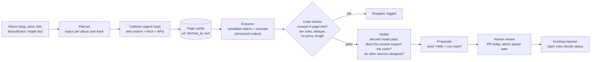

# Plan: the information finder

Written for: the project owner, to decide direction before any code. Nothing here is built yet.

## Decisions (2026-11-22)

- **Output:** seed files in a pull request first; admin-queue drafts later.
- **Hosting:** code-controlled Python workflow, run from the command line.
- **First scope:** steps 0 to 3 below.
- **Budget:** use the Claude subscription, not pay-per-token API calls. LLM stages go through a swappable `LLMBackend`: Claude Code in headless mode first (confirm the exact flags and the subscription terms before building it, in step 2); a Messages API backend later for scale.
- **Nail a couple of albums first:** the gold set is two albums (*Animals* plus one the owner picks) before anything runs in bulk.
- **Progress:** step 0 (spec, gold set, scoring) and step 1 (no-AI collectors and cache: `uv run python -m app.research collect animals`) are built. Step 2 (extractor with Claude Code headless on the subscription, plus deterministic checks) is built; run log in `apps/api/evals/RESULTS.md`. Step 3 (verifier, conflict detection and hand-picked press pages via `research.yaml`) is built. Step 4 (finding pages by search, tracing quotes to primary sources) is next.

## What it is

An agent that researches an album on the web and hands back **draft claims with sources**, in the exact shape the app already uses, for a human to review. It is the first real implementation of the `app/pipeline/` idea from `docs/PLAN.md` (collector, extractor, verifier), and the answer to `docs/FEATURES.md` Z1 and K2.

The research notes for *Animals* show what the job is and where it is hard:
- Facts about recording, personnel and release are easy to find, but mostly in tertiary sources (Wikipedia).
- Artist intent ("what Waters meant") reaches us second-hand, and the app's rule 2 needs a **primary** source before it can be approved. Tracing a quote back to the original interview or book is the highest-value, hardest step.
- Sources disagree (the pig's size, shoot date) and the agent must say so, not pick one.
- It must never reproduce lyrics, and must never invent a source.

## "Trained", and what I recommend

I would not fine-tune a model. The quality here comes from the **instructions, the tools, hard checks in code, and a measured eval loop**, and a fine-tune would not help with the main risk, which is made-up sources. "Training" means: build a gold set of albums we already researched by hand, score every change to the prompts and tools against it, and keep what improves the score. That loop is described under [Evaluation](#evaluation-this-is-the-training).

## Design principles

1. **The model proposes; code verifies; a human approves.** Nothing the agent produces is trusted until a deterministic check passes, and nothing goes public without review. It can never approve a claim (rules 1 to 5 stay in `claim_rules.py`).
2. **Every claim carries evidence we can check.** Each claim has at least one source with a short verbatim excerpt. Code confirms that the excerpt really appears in the page text we fetched. If it does not, the claim is dropped.
3. **Honest tiers.** The agent cannot award a source "primary" by itself. Tier comes from rules (domain and kind) plus a human check, and a claim only gets a primary source when the agent actually reached the original.
4. **Conflicts are findings.** Disagreeing sources become `contradicts` entries, which rule 3 already turns into a flagged review item.
5. **Small excerpts, no lyrics, no page copies.** We store short excerpts and links, never full articles, and never lyric text.
6. **Web pages are data, not instructions.** Fetched text is treated as untrusted. The agent has no tool that can change anything except writing proposals.

## Architecture

**Stages** (these map onto the planned `SourceCollector`, `ClaimExtractor`, `ClaimVerifier` interfaces in `apps/api/app/pipeline/`, which is empty today):

| Stage | Job | Tools | LLM? |
|---|---|---|---|
| Planner | List what to look for per album and per song (origin, recording, credits, intent, reception, conflicts) and which claims already exist so we do not duplicate | Existing DB and seed files | Yes (cheap) |
| Collector | Find and fetch sources. Includes **primary-source tracing**: follow a citation from Wikipedia or Songfacts to the original interview, book or liner notes | Web search, web fetch, MusicBrainz, Wikipedia API, Internet Archive | Yes, agentic loop |
| Extractor | Turn stored page text into candidate claims in our shape (type, depth, short body, excerpt, locator, stance) | None (reads cached text) | Yes, structured output |
| Code checks | Verbatim excerpt match, domain-based tier, duplicate detection, length caps, lyric guard, schema validation with the existing seed validators | n/a | No |
| Verifier | Independent pass with a different prompt: does the excerpt actually support the claim, is the type right (fact versus artist intent versus interpretation), do other sources conflict | Cached text only | Yes |
| Output | Write proposals and a run report | n/a | No |

**One technical note that shapes the design:** the API's built-in Citations feature cannot be combined with structured outputs. So we do not rely on it. We ask for structured candidates with excerpts and verify the excerpts ourselves against the cached text, which is stricter anyway.

## Output: proposals as seed files, reviewed in a PR first

The agent writes the **existing seed format** (`content/albums/<slug>/…`, validated by `seed_loader.py`) into a proposals folder on a branch, plus a run report listing what was found, dropped and why. A human reviews the diff in a pull request; accepted proposals are merged into the real seed files and imported.

Why this first: it reuses the importer and rules untouched, gives a reviewable diff for free, and needs no new tables or admin UI. Later, once the admin review UI (FEATURES A1) exists, proposals can land directly as draft claims with a provenance record (run id, model, prompt version, URL, fetched time, excerpt). Everything the agent emits stays `reviewed: false`, so the importer files it as a draft.

## Source policy

- **Prefer APIs and stable sources:** MusicBrainz (credits, ids), Wikipedia API, Internet Archive (books, magazines, recordings), official artist and label sites, reputable press.
- **Tier by rule, confirm by human:** Wikipedia, Songfacts, databases are tertiary; press about the artist is secondary; the artist's or participant's own words in an original interview, liner notes or book are primary. The agent may suggest `primary` only with a link to the original.
- **Avoid:** lyric sites, paywalled scraping, anything whose terms forbid automated access. Check each domain's terms before adding it to the allowlist; keep an explicit allowlist and denylist in config.
- **Politeness:** cache every page, rate-limit per domain, send an honest user agent, respect robots.txt.

## Evaluation (this is the "training")

Build the gold set first, before the agent is clever.

- **Gold set:** *Animals* (we already have the research notes and the reviewed seed content) plus two or three more albums researched by hand to the same standard. Split into train, validation and a held-out test album that is never tuned against.
- **Metrics per run:**
  - Excerpt-match rate (must be 100% after code checks; a drop means the model is inventing).
  - Claim support rate, judged by a separate grader against the cached text.
  - Recall of the gold facts (did it find what we found by hand).
  - Primary-source tracing: of the artist-intent claims, how many reached a real primary source, and how many were wrongly labelled primary.
  - Conflict detection (did it flag the pig-size disagreement).
  - Duplicate and lyric-leak rate (target zero lyrics).
  - Cost and time per album.
- **Loop:** change a prompt, tool or rule, rerun, keep it only if the score improves on validation and the test album does not regress. The Claude API skills `build-eval` and `hillclimb` describe this workflow and can be used when we get there.

## Build order (one PR each)

| # | Step | Result |
|---|---|---|
| 0 | Spec and gold set: freeze the proposal format, extract Animals gold items from the existing seed and research notes, write the scoring script | A score for "no agent" (zero) and a way to compare |
| 1 | Deterministic collectors, no LLM: MusicBrainz credits and ids, Wikipedia article text with its reference list, page cache | Baseline data and the cache everything else reads |
| 2 | Extractor and code checks on cached pages: structured candidates, verbatim excerpt check, tiering rules, dedupe, lyric guard | First proposals from Wikipedia plus press, score recorded |
| 3 | Verifier pass and conflict detection | Fewer unsupported claims; the pig-size case flagged |
| 4 | Agentic collector with web search and fetch, then **primary-source tracing** from second-hand quotes | The step that unlocks artist-intent claims |
| 5 | Proposals as a branch and PR, run report, provenance | Reviewable end to end: `uv run python -m app.research <slug>` |
| 6 | Eval loop on held-out albums, cost caps, model tuning | Measured quality and cost per album |
| 7 | Admin queue integration (needs FEATURES A1) | Proposals land as drafts with provenance |

Each step is useful on its own; stopping after step 2 or 3 already beats hand-gathering for facts.

## Technology choices (recommended)

- **Where:** Python in `apps/api/app/pipeline/`, run as a CLI first (`python -m app.research <slug>`), a background job later. It is separate from the web request path.
- **Approach:** a **code-controlled workflow** with an agentic collector inside it, using the Claude Messages API with the web search and web fetch server tools, rather than one free-roaming agent. The stages are predictable, so code should own the order, budgets, caching and checks. A hosted agent (Anthropic's Managed Agents) is an alternative worth revisiting for long unattended research; it is a beta product that bills runtime on top of tokens and keeps session history, so I would not start there.
- **Models:** start with `claude-opus-5-5` for the collector and verifier and measure. After the eval exists, test whether a cheaper model (for example `claude-sonnet-5-5` or `claude-haiku-5-5`) holds quality for extraction and verification. Do not downgrade before measuring.
- **API details to honour when writing it:** thinking is always on for Opus 5.5 and the default effort is `medium` (set it explicitly); forced tool choice is rejected, so use `auto` with strict tool schemas; include the server-side refusal `fallbacks` option; cap spend per album with a task budget plus our own counter.
- **Prompt-injection defence:** fetched text goes in a clearly delimited data block; the agent's only write tools are `propose_source` and `propose_claim`, which write to the sandbox, never to the database or repo.

## Risks and how the plan handles them

| Risk | Mitigation |
|---|---|
| Invented sources or quotes | Verbatim excerpt check against cached text; unverifiable claims are dropped |
| Wrong tier (Wikipedia called primary) | Tier from domain rules; `primary` needs a link to the original; human confirms |
| Copyright | Short excerpts only, no page copies in the repo, no lyrics, lyric guard in code, domain allowlist |
| Prompt injection from pages | Data-only handling, no powerful tools, human review |
| Cost runaway | Per-run and per-album budget, page cache, resumable runs, cheap planner |
| Quality drift as prompts change | Fixed gold set, held-out album, scores recorded per run |
| Confidently resolving real conflicts | Conflicts must be emitted as `contradicts`, scored in the eval |
| Site terms and scraping limits | Allowlist, rate limits, robots.txt, APIs first, legal check before widening |

## Open decisions

1. **Output path:** PR of seed files first (recommended) or straight to DB drafts once the admin UI exists?
2. **Budget:** maximum spend per album and per month. I will measure real cost at step 2 and bring numbers back before step 4.
3. **Allowed sources:** which sites, and who checks their terms. Is paid access to anything (for example archives of magazines) acceptable?
4. **Hosting model:** plain workflow now (recommended) versus Managed Agents later.
5. **Which albums form the gold set,** beyond *Animals*, ideally spanning eras and with well-documented interviews.
6. **Trigger:** run on demand for one album, or queue new albums automatically?
7. **Human reviewer:** you alone for now, or do we plan for others (affects the admin UI and the rules for who can approve)?

## Where this goes in the backlog

Add to `docs/FEATURES.md` under "Later and maybe" Z1 as sub-items Z1.0 to Z1.7 matching the build order above, and link K2 (primary-source retrieval) to step 4.
